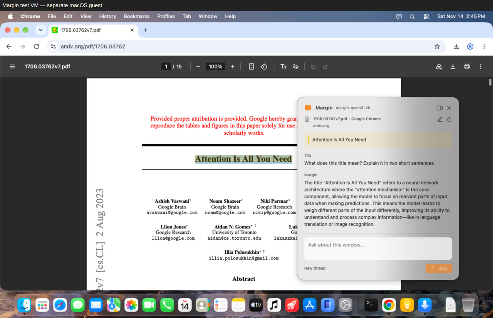
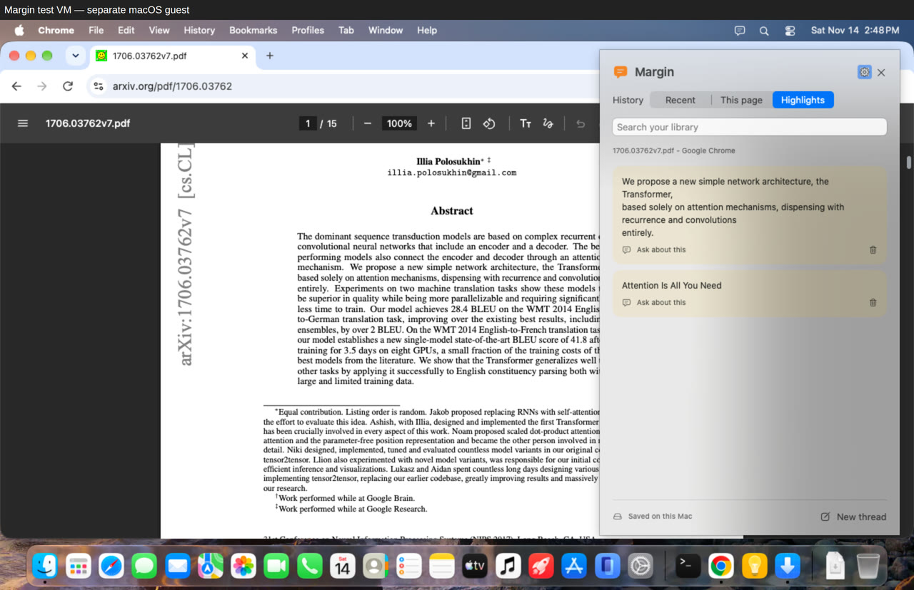

# Margin

A native macOS reading assistant beside your cursor. Keep your paper in Chrome or Safari, ask about the current window, and return to your saved highlights and conversations later.

For macOS 26 or later. Answer with your signed-in [Codex CLI](https://github.com/openai/codex) or an OpenAI-compatible API. Your library saves locally in SQLite from the first launch.

## Demos

Recorded in Chrome on macOS 27.2 with the released beta and a real local Qwen3 model through the API backend. Click a preview to watch. Clips cut idle pauses; playback stays at normal speed.

| Ask beside the paper | Keep separate threads |
| --- | --- |
| [](https://github.com/jackboyla/margin/releases/download/v0.1.0-beta.1/margin-paper-question.mp4) | [](https://github.com/jackboyla/margin/releases/download/v0.1.0-beta.1/margin-multiple-threads.mp4) |

Also watch [a question with no text selected](https://github.com/jackboyla/margin/releases/download/v0.1.0-beta.1/margin-window-context.mp4) and [starting a thread from a saved highlight](https://github.com/jackboyla/margin/releases/download/v0.1.0-beta.1/margin-saved-highlight.mp4).

## Install

1. Download the DMG from [GitHub Releases](https://github.com/jackboyla/margin/releases).
2. Open the DMG, drag **Margin** to **Applications**, then open it from Applications.
3. In **Settings → Reading**, grant Device Control (Accessibility on macOS 26) and Screen Capture. macOS 27 calls the first permission **Device Control and Data Access**. Press **Control–Shift–H** to return to Margin after granting access. Allow Chrome or Safari Automation when macOS asks so Margin can associate notes with the page URL.
4. In **Settings → Models**, choose Codex or an API provider and save your settings. Codex needs an existing `codex login`; API setup needs a model name and any required API key.

Ad-hoc beta builds are not notarized by Apple, and Gatekeeper may block them. If you trust the download, attempt to open it, then use **System Settings → Privacy & Security → Open Anyway** when macOS offers it. See [Apple's opening guidance](https://support.apple.com/en-us/102445) and check each release's signing notice.

## Use

- **Control–Shift–Space** opens a question box beside the pointer. Select text before opening it, or leave the selection empty to ask about the window.
- Select more text in the source window and return to the box to include that passage. The source page stays pinned; changing pages requires capturing the new page.
- The **highlighter** button saves the selected passage without contacting the agent.
- **Control–Shift–H** opens the sidebar: search recent conversations, view this page's threads and highlights, or open Settings.
- **Ask about this** starts a conversation from a saved highlight. Open a thread in the sidebar to continue it. Codex threads keep their own agent session; API threads retain their conversation history.
- **Escape** closes the panel. **Stop** interrupts the agent request.

Questions include captured text and the document's saved highlights. Codex also receives the available window image; API images require opting in for a vision model. A window capture covers the chosen window, not the unread pages of an entire paper.

The API presets cover OpenAI, Claude's OpenAI compatibility endpoint, Ollama, and LM Studio. Enter an explicit model name; image and streaming support depend on the model and server. API keys stay in macOS Keychain. See [provider setup](docs/providers.md).

## Library

Notes save immediately in a local SQLite database. Document records, captured text, highlights, and conversations stay on this Mac, alongside window images. Codex keeps its own session files. Existing JSON libraries migrate automatically. See [storage, migration, and backups](docs/storage.md).

## Build

On macOS 26 or later, install Xcode 26.3 or later with its macOS SDK and Swift 6.2 or later, then:

```sh
swift test
bash scripts/build-app.sh
open dist/Margin.app
```

Builds use ad-hoc signing by default. Keep the app at a stable path when granting permissions; ad-hoc rebuilds can require granting them again. See [development and isolated testing](docs/development.md) for repeated builds and [release packaging](docs/releases.md) for universal DMGs, Developer ID signing, and notarization.

## Current limits

- The PDF workflow is tested in Chrome. Safari PDF text selection is not yet verified on macOS 26 or later.
- Restored highlights mark visible text lines using text recognition. They do not modify the webpage or PDF. A quote must match uniquely; missing or repeated text stays unpainted and remains in the sidebar. Math, columns, and scanned PDFs can defeat matching.
- Chrome and Safari page identity uses their URL. Other apps depend on the document URL they expose or their window title; changed titles can create separate records.
- Each arXiv paper version has its own identity. HTML, abstract, and PDF URLs for the same identifier share a library entry; unrelated query parameters and fragment routes remain significant.
- Shortcuts are fixed.
- API conversations use streaming Chat Completions. Read-only agent tools are available through Codex; direct API conversations require a model that answers with text.

## Structure

`MarginCore` owns the library and document identity. `Margin` owns native windows, global shortcuts, source capture, and the agent process. The UI persists requests before starting execution and retains the source context with each question.

MIT licensed. Interaction references: [My-Monkey's OpenSuperWhisper](https://github.com/my-monkeys/OpenSuperWhisper) and [T3 Code](https://github.com/pingdotgg/t3code).
